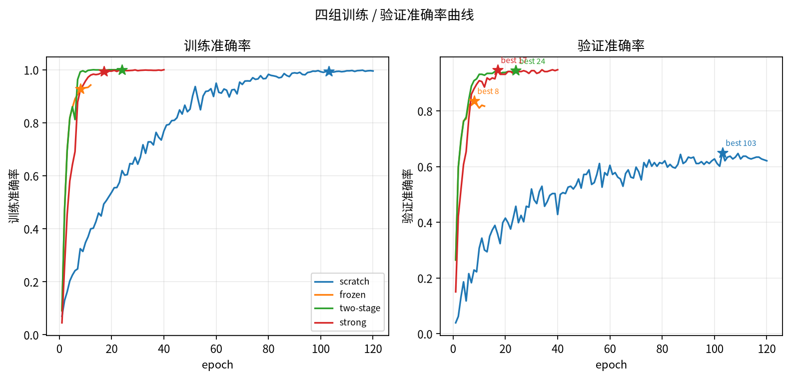
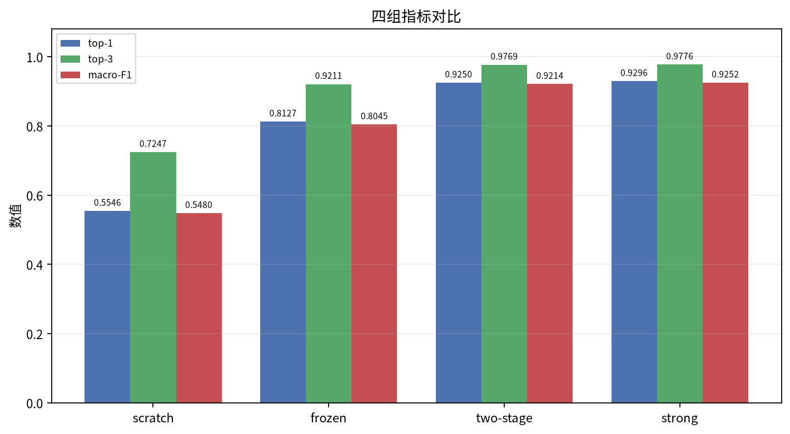
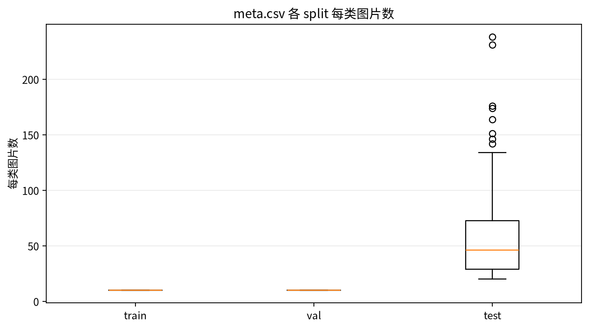
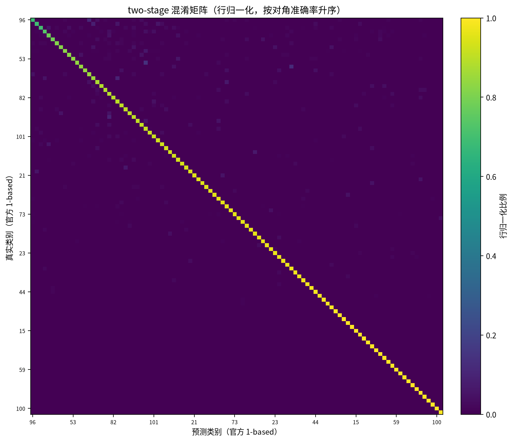
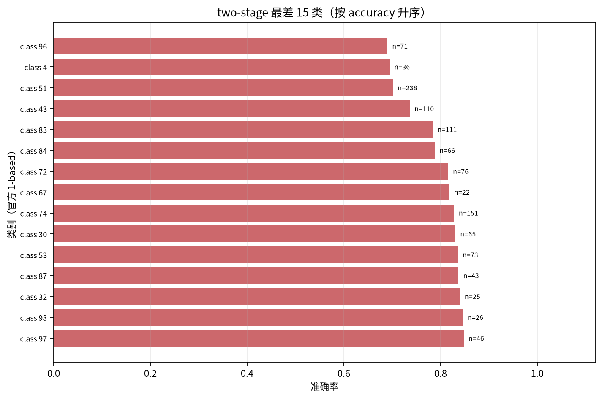
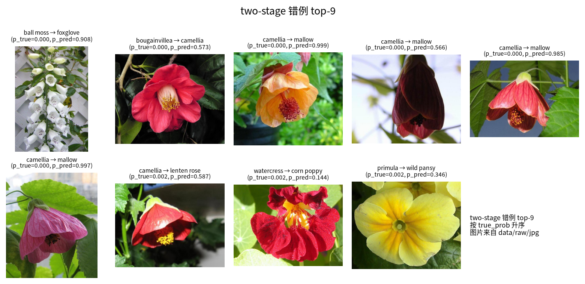

# 从零？不，借用——牛津 102 花卉细粒度分类的迁移学习实验

## 一、为什么不能让计算机从零开始学认花

牛津 102 花卉是细粒度小样本任务：102 类，训练、验证各 1020 张，测试 6149 张；类间差异常只在花瓣形状、花蕊颜色或叶片排列。scratch 从随机初始化训练 120 个 epoch，test top-1 为 55.46%、val top-1 为 65.03%，训练准确率 99.54%；验证与测试约 9.57 个百分点的落差说明它记住的是训练样本的纹理与背景，而非可迁移的花卉特征。

frozen 只训最后一层，12 epoch、122.6 秒（约 2 分钟），test top-1 81.27%、val 83.66%。仅因骨干来自 ImageNet 预训练，结果从“勉强过半”跳到“八成以上”。

从四组 `history.csv` 取第 12 epoch 的 val top-1 做同 epoch 对照：

| 组别 | 第 12 epoch val top-1 | 总 epoch |
|---|---:|---:|
| scratch | 30.07% | 120 |
| frozen | 81.70% | 12 |
| two-stage | 92.81% | 25 |
| strong | 88.56% | 40 |

即使 epoch 相同，scratch 仍远低于另外三组；它后来追到 55.46%，靠的是额外 108 个 epoch，而非同等预算下的效率。

图 1 与图 5 显示：frozen 很快进入高准确率区间，scratch 长期在 30%–65% 之间爬升且始终落后。在这个数据规模上，“从零训练”不是合理默认，而是高成本消融。

## 二、迁移学习的原理：借用的是什么

ResNet-18 在本任务中共有 11,228,838 个参数；frozen、two-stage、strong 首阶段只训练分类头，可训参数 52,326 个，约占总参数的 0.47%，scratch 则训练全部 11,228,838 个。所谓“只换最后一层”，就是把 512 维特征接到 102 维分类器：$512\times102+102=52{,}326$。分类头映射到 102 类，骨干保持 ImageNet 权重。

ImageNet 预训练的 ResNet-18 在 ImageNet 验证集 top-1 为 69.758%（torchvision 官方权重说明）。这不代表花卉准确率，但说明骨干已学会通用视觉基元：浅层响应边缘、颜色与纹理，中层组合花瓣轮廓、花蕊与叶片，深层形成部件级表示。花卉分类需要的正是这些部件差异；迁移借来“看东西”的能力，只重新学习“区分这 102 种花”。

迁移并非无条件有效：目标域越接近、骨干越深，收益通常越明显；差异极大时冻结全部骨干可能限制性能。two-stage 与 strong 先冻结骨干稳定分类头，再解冻全部参数做小学习率微调。

## 三、方法：两阶段微调与关键设置

`data/meta.csv` 共 8189 张、102 类，每类 40–258 张；官方划分为 train 1020、val 1020、test 6149。train+val 合并 2040 张，按类内 sha256 每类抽 3 张验证，得到 1734 训练、306 验证；test 6149 只在最终评估使用。这里不用 `random.shuffle`：随机序列跨版本无稳定契约，sha256 分桶保证划分确定性。

| 组别 | 预训练 | stage 1 / 2 | lr_head | lr_backbone | 增强 | 标签平滑 | BN（stage1→2） |
|---|---|---|---:|---:|---|---:|---|
| scratch | 无 | 0 / 120 | $10^{-3}$ | $10^{-3}$ | baseline | 0.0 | train → — |
| frozen | ImageNet | 0 / 12 | $10^{-3}$ | 0 | baseline | 0.0 | frozen → — |
| two-stage | ImageNet | 5 / 20 | $10^{-3}$ | $10^{-4}$ | baseline | 0.0 | frozen → train |
| strong | ImageNet | 5 / 35 | $10^{-3}$ | $10^{-4}$ | strong | 0.1 | frozen → train |

四组 batch 64、AdamW、weight decay 0.01、cosine 衰减到 0。baseline 增强为 `RandomResizedCrop(224, scale=(0.6,1.0))` 加水平翻转；strong 把裁剪下界降到 0.35，并加入旋转、颜色抖动与 RandomErasing。two-stage 与 strong 在第 6 epoch 解冻骨干并重建优化器与 scheduler，分类头动量重置，epoch 6 允许 loss 抖动；不为此改语义。frozen 全程冻结骨干 BN；two-stage/strong 解冻后恢复 BN 训练。

图 6 显示 train/val 每类各 10 张，test 每类 20–238 张；这是 macro-F1/top-1 差距的来源之一。

## 四、结果：准确率、混淆矩阵与公开结果对比

四组结果（数据源：`report/results.csv` 与 `runs/*/metrics.json`）：

| 组别 | test top-1 | test top-3 | test top-5 | macro-F1 | val top-1 | best epoch | epochs | 耗时（秒） |
|---|---:|---:|---:|---:|---:|---:|---:|---:|
| scratch | 55.46% | 72.47% | 78.97% | 54.80% | 65.03% | 103 | 120 | 1350.2 |
| frozen | 81.27% | 92.11% | 94.67% | 80.45% | 83.66% | 8 | 12 | 122.6 |
| two-stage | 92.50% | 97.69% | 98.75% | 92.14% | 94.44% | 24 | 25 | 241.7 |
| strong | 92.96% | 97.76% | 98.52% | 92.52% | 94.77% | 17 | 40 | 552.1 |

macro-F1 与 top-1 差距为 0.66/0.82/0.37/0.43 个百分点。macro-F1 对每类一视同仁，而 test 中 petunia 有 238 张、部分类别仅 20 张，说明少数类略弱；two-stage/strong 上差距已较小。

图 2 为 102×102 混淆矩阵，行归一化并按对角准确率升序重排。对角线集中；左上角行即后文最差类，第一行即 camellia（69.01%）。

公开结果不可直接比较（数据版本、划分、骨干、训练协议不同），只做量级参照：Nilsback & Zisserman 2008 的 72.8% 来自 103 类旧版、手工特征+SVM；CCT-14/7×2 的 99.76% 是 from scratch Transformer 配方；Springer 2026 的 ViT-L/16、ConvNeXt-V2-Tiny 为 99.37%、98.13%，官方划分+迁移，骨干 303.4M/27.9M；PLOS ONE 2025 表 3 的 ResNet-50（Fast AA）97.90%（二手汇总）。未找到可核验一手“ResNet-18 + 官方 split + 全网络微调”结果，因此只做量级对照，不宣称超越或落后：two-stage/strong 在 92%–93%，与 98%–99% 仍有差距，但考虑 11.2M 参数与单卡 T4 预算，迁移学习有效。

## 五、错例分析：模型在哪里栽跟头

two-stage 的 `per_class.csv` 中，准确率最低的 15 类见图 4：camellia、sweet pea、petunia（n=238）、sword lily、hibiscus、columbine、azalea、spring crocus、rose、sweet william、primula、magnolia、garden phlox、ball moss、mallow；最低三类 69.01%/69.44%/70.17%。图 4 展示这 15 类；petunia 样本量最大，出错对总体拖累最大。

`top_confusions.csv` 前 10 个混淆对（花名来自社区 `cat_to_name.json`，已转成 `data/class_names.csv`，非官方）：petunia→hibiscus 12、rose→cyclamen 9、petunia→sweet william 8、camellia→mallow 8、petunia→corn poppy 7、petunia→morning glory 7、magnolia→cyclamen 6，petunia→balloon flower/garden phlox/mexican petunia 各 5。petunia 占 6 条，错误多流向花瓣宽大、颜色鲜艳的类别；模型对“大花瓣 + 高饱和颜色”的全局外观更敏感，对花冠筒、花蕊形态等细粒度线索利用不足。

图 3 取 `true_prob` 最小的 9 条，其中 4 条是 camellia→mallow（如 `image_07683`），true_prob 0.000077–0.000110，模型却以 0.57–0.999 置信度判成 mallow；这些样本多为单朵特写、花瓣层叠、绿叶背景。`image_07303` 标签为 ball moss，模型以 0.908 判成 foxglove；邻近 `image_07304` 同为 foxglove，很可能是标注噪声。`image_03720`（primula→wild pansy，true_prob=0.002270、pred_prob=0.346）则是同色系小花混淆。

错例可归为四类：形态相近（camellia/mallow、petunia/hibiscus）、同色系（rose/cyclamen、primula/wild pansy）、背景干扰、单朵特写与花丛构图差异。模型依赖物体级背景/颜色，而非花蕊、花萼等部件结构。

## 六、讨论：这套方法的边界

第一，结果来自单 seed，无种子方差；two-stage 与 strong 的 0.46 个百分点差距不能当作稳定优势。第二，验证集仅 306 张、每类 3 张，best epoch 噪声不小：frozen 8/12、two-stage 24/25、strong 17/40，选择点影响 test。第三，`loss` 不可跨组比较：strong 用 label smoothing 0.1，与其余三组不同尺度。第四，scratch 获得最多 120 epoch，其劣势是下界而非上限。第五，strong 相对 two-stage 是“强增强 + 标签平滑 + 更长训练”的三因素 bundle，0.46 个百分点不能归因于单一因素。第六，确定性只承诺记录 `strict` 与固定种子，不承诺跨 GPU/CPU 位级复现。test 每类 20–238 张的不均衡会影响 macro-F1 与错例统计。

继续做会优先：多 seed 重复并报告均值/方差；针对 petunia、camellia、sweet pea 等最差类别做类别平衡采样或 logit adjustment；换更大骨干（如 ConvNeXt-Tiny）或更强细粒度增强，与公开结果做可比对照。当前 11.2M 参数的 ResNet-18 已证明“借用 ImageNet 特征”能把小样本花卉分类从 55% 推到 93%，但离专家级细粒度识别仍有清晰距离。
